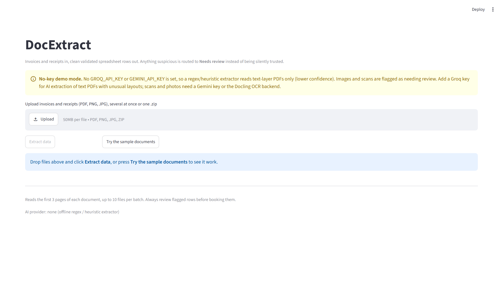
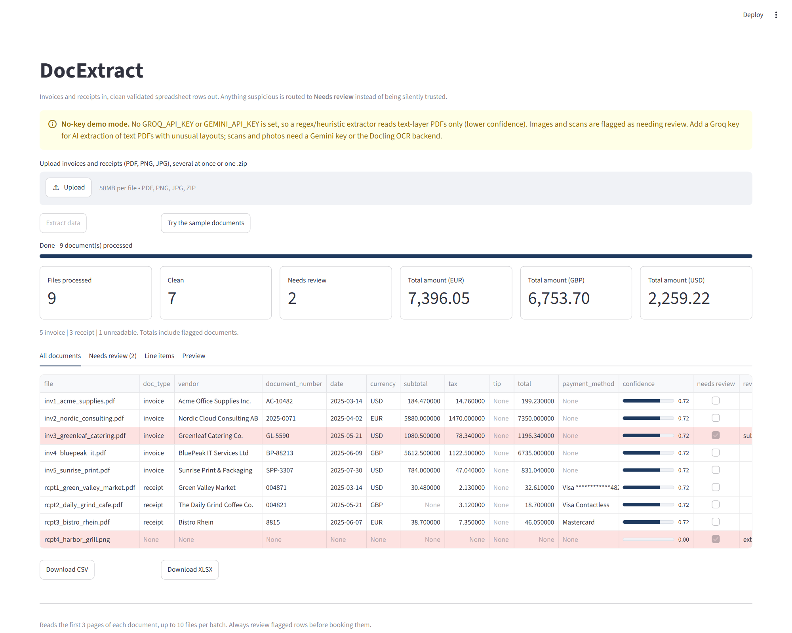
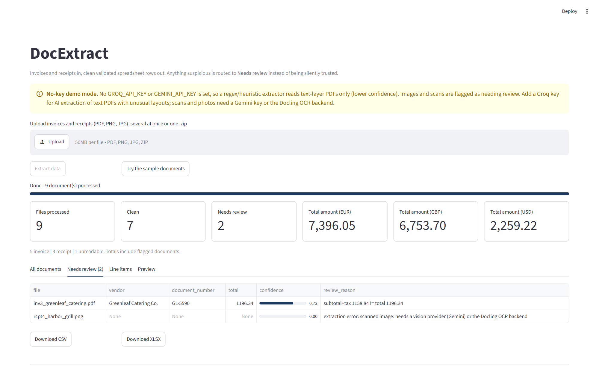

# DocExtract: invoices and receipts to clean, validated Excel

Drop in a pile of invoice and receipt PDFs, scans or phone photos (or one ZIP). Get one validated row per document,
every line item, and a separate **Needs review** sheet for anything that does not add up.

## The problem
Small businesses, bookkeepers and agencies still retype vendor, number, date, tax and total from hundreds of
documents into spreadsheets. It is slow (3-5 minutes per document by hand is a fair estimate), and one mistyped total
quietly corrupts the books. Generic OCR tools hand you raw text and no way to know which numbers to distrust.

## What it does
- **Invoices and receipts**, auto-detected per document (`invoice` / `receipt` / `other`).
- **Batch intake**: many files at once, or a single `.zip`. PDF (text or scanned), PNG, JPG.
- **Structured output**: vendor / merchant, document number, date (ISO), currency, line items, subtotal, tax, tip, total, payment method, confidence.
- **Summary cards**: files processed, clean, flagged, and total amount per currency (USD, GBP and EUR are never added together).
- **Validation**: arithmetic cross-checks; failures land in **Needs review** with the reason in plain English.
- **Exports**: CSV and XLSX (sheets `documents`, `needs_review`, `line_items`; flagged rows highlighted), optional Google Sheets append.
- **Works with no API key** in a clearly labelled demo mode (text-layer PDFs), so anyone can try it instantly.
- **AI provider of your choice**: Groq (free-tier key, text-layer PDFs) by default, Gemini optional (adds vision for scans and photos).

## Screenshots
Captured from the running app in **no-key demo mode** (the yellow banner), which is why the PNG receipt is flagged too.
With an AI key the banner is green; with Groq the PNG receipt is still flagged (Groq reads text only, see
[AI provider](#ai-provider)), with Gemini or Docling OCR it is read.

| Home screen: uploader and the sample button | Summary cards and all documents (flagged rows in red) |
|---|---|
|  |  |

**Needs review tab**: the Greenleaf invoice (`subtotal+tax 1158.84 != total 1196.34`) and the image-only receipt.



## How it works
```
 PDF / PNG / JPG / ZIP
        |  ingest: unzip in memory, read the text layer (pypdf), render pages (pypdfium2)
        v
 extract
   text-layer PDF -- GROQ_API_KEY -----> Groq text model (openai/gpt-oss-120b), JSON mode, schema in the prompt
   scan or photo --- GEMINI_API_KEY ---> Gemini vision (gemini-3.1-flash-lite), JSON constrained to the Document schema
   scan or photo --- Groq + Docling ---> Docling OCR -> text -> Groq text model
   no key ---------------------------> regex / heuristic parser over the text layer (lower confidence, text PDFs only)
   scan or photo with no OCR / vision route -> Needs review row, never a guess
        v
 validate: totals cross-checks, missing fields, confidence   ->  needs_review + reason
        v
 table in the UI  ->  CSV / XLSX / optional Google Sheet
```
- **Ingest**: up to 3 pages per document are read (`MAX_PAGES`); zip members are read in memory, never written to disk, and path tricks are stripped.
- **Extract (Groq)**: the PDF text goes to the Groq text model through plain `httpx` (OpenAI-compatible `/chat/completions`, JSON mode, `temperature=0`) with the schema spelled out in the prompt, and the reply is parsed into the same typed `Document`. Rate-limit and overload responses (HTTP 429/500/502/503/504) and network errors are retried with exponential backoff (a `Retry-After` is honoured); a bad key or a model that no longer exists fails at once. Anything unparseable becomes a Needs review row.
- **Extract (Gemini)**: the page images and the PDF text go to `gemini-3.1-flash-lite` through `google-genai` with a pydantic response schema (`temperature=0`), with the same retry rules.
- **Extract (no-key mode)**: layout-preserving text from `pypdf`, then regex rules for labels (`Subtotal`, `VAT (20%)`, `Total Due`, `Includes VAT`, `Tip`), five date styles (ISO, `03/14/2025`, `07.06.2025`, `09 June 2025`, `Jun 21, 2025`; ambiguous day/month order is decided by currency), currency symbols and codes, and four line-item layouts (qty/unit/amount columns, `2 @ 3.49`, `2 x item`, price-only). Confidence is capped at 0.72 on purpose.
- **Optional Docling backend** (`pip install -r requirements-docling.txt`): IBM's [Docling](https://github.com/docling-project/docling) layout/table model plus OCR. With **Groq** it is the way to read scans and photos: when a file has no text layer and Docling is installed, Docling OCRs it and the text goes to the Groq text model. In no-key mode (`EXTRACT_BACKEND=docling`) it lets the heuristic parser read **images and scans** (the PNG receipt in `samples/` is parsed correctly), and for text PDFs it parses both the Docling and the pypdf text and keeps whichever validates cleaner. It is heavy (about 1.6 GB of packages, about 650 MB of models downloaded on first use; roughly 3-5 s per PDF and 15-30 s per image on a laptop CPU), so it is off by default and not installed on the free Render demo.
- **Document model**: `core.py` -> `Document` (doc type, vendor, number, date, currency, line items, subtotal, tax, tip, total, payment method, confidence).

## AI provider
Pick the provider with `LLM_PROVIDER` (`groq` | `gemini` | `none`). If it is unset: Groq when `GROQ_API_KEY` is set, else Gemini when `GEMINI_API_KEY` is set, else `none` (the offline demo mode). A provider whose key is missing falls back to `none`.

| Provider | Reads | Needs | Notes |
|----------|-------|-------|-------|
| **Groq** (default when its key is set) | text-layer PDFs; scans and photos only through the optional Docling OCR | free key from <https://console.groq.com/keys> | default model `openai/gpt-oss-120b` (`GROQ_TEXT_MODEL=openai/gpt-oss-20b` is the faster, cheaper option). Groq currently serves **no vision-capable model**, so it never sees page images. A scan or photo without Docling becomes a Needs review row: `scanned image: needs a vision provider (Gemini) or the Docling OCR backend`. |
| **Gemini** (optional) | PDFs, scans and photos with vision | free key from <https://aistudio.google.com/apikey> | `gemini-3.1-flash-lite`; Gemini 2.x Flash models return 404 on the free tier. Set `LLM_PROVIDER=gemini` when both keys exist and you have scans. |
| **none** | text-layer PDFs with regex rules | nothing | lower confidence (capped at 0.72); images and scans are flagged |

Groq retires and renames models; confirm the current ids with `GET https://api.groq.com/openai/v1/models` (header `Authorization: Bearer $GROQ_API_KEY`). A Needs review row mentioning `model_not_found` means the id in `GROQ_TEXT_MODEL` changed. `GROQ_BASE_URL` points the client at any OpenAI-compatible endpoint (the offline tests use a local fake server).

**Live check with your own key:** `python smoke_groq.py` runs the 9 samples through Groq and prints a table (file, type, vendor, total, needs_review, model used, match against the generator's ground truth). It is the only script that calls the real API.

## Accuracy and validation approach
The design assumption is that extraction will sometimes be wrong, so wrong values must be *visible* instead of trusted.

| Check | Flags the row when |
|-------|--------------------|
| Line items vs subtotal | sum of line amounts differs from the subtotal |
| Subtotal + tax (+ tip) vs total | the printed total does not equal subtotal + tax + tip |
| Tax-inclusive receipts | no subtotal printed: items (+ tax / tip) must equal the total, whether prices include tax or not |
| Completeness | total, line items, vendor or date missing |
| Document type | the file is neither an invoice nor a receipt |
| Confidence | model (or heuristic) confidence is below 0.70 |
| Extraction error | unreadable file, scan or photo with no vision / OCR route, malformed model reply, API failure after retries |

Tolerance is 0.5% of the amount or 5 cents, whichever is larger (rounding noise only). Only amounts that actually contradict
each other are flagged; a document whose arithmetic is consistent but whose digits were misread can still pass, which is why
the Preview tab shows the original next to the extracted fields and why a human should skim totals on high-value documents.

**What is tested** (`python verify.py`, offline, no API key, about 20 seconds):
1. CLI on the 9 bundled samples in no-key mode: 9 processed, the deliberately wrong invoice is flagged, and the 8 text-layer documents match the generator's ground truth on type, vendor, number, date, currency, tax and total; XLSX has the three sheets; the CLI is not capped by `MAX_FILES`.
2. ZIP intake: nested zips, junk files and `../` paths are handled.
3. Gemini code path against a **local fake Gemini server**: two 503s are retried then succeed, JSON parses, and a permanently failing API becomes a Needs review row instead of a crash.
4. Groq code path against a **local fake OpenAI-compatible server**: the text PDF reaches the text model with JSON mode and the schema in the prompt and parses clean; a 429 is retried; a persistent 500, malformed JSON, a schema-breaking reply, a 401 and an exhausted quota each become a Needs review row; scans and photos make no API call and are flagged (or, with Docling stubbed in, OCR text goes to the text model); provider-selection rules; the CLI and `smoke_groq.py` run end to end against the fake.
5. The Streamlit app via `AppTest`: provider banners, the `MAX_FILES` cap warning, the sample batch and the summary cards.
6. If Docling is installed: the optional backend reads all 9 samples, including the PNG, and flags only the wrong-total invoice (skipped otherwise).

The fake servers prove the wiring, not the models. **Not verified here:** a real Groq or Gemini call, and real-world accuracy of either model; run `python smoke_groq.py` for the former. The bundled samples are synthetic: real accuracy depends on scan quality and layout, so send a handful of your own documents to see it on yours.

## Run it
```powershell
python -m venv .venv
.venv\Scripts\activate                # macOS/Linux: source .venv/bin/activate
pip install -r requirements.txt
copy .env.example .env                # optional: add GROQ_API_KEY (or GEMINI_API_KEY) for AI mode
python make_samples.py                # optional: regenerates samples/ (9 files)
streamlit run app.py                  # web UI
python extract.py samples --out out.csv --xlsx out.xlsx     # CLI (folders, files, zips; add --sheet, --no-key)
python verify.py                      # one-command offline self-check
python smoke_groq.py                  # live Groq check (needs GROQ_API_KEY)
# optional OCR backend (heavy; on Windows use a short venv path such as C:\dl\v):
#   pip install -r requirements-docling.txt
```

Google Sheets (optional): set `GOOGLE_SERVICE_ACCOUNT_JSON` (path to the key file) and `SHEET_ID` in `.env` and share the sheet with the
service account's email. The **Push to Google Sheet** button appears only when both are set; leave them unset on a public demo.

## Deploy
The live demo runs on **Render's free web service** (Docker runtime): the `Dockerfile` binds to `$PORT`, `render.yaml` is a one-file
blueprint, and `GROQ_API_KEY` is set as an environment variable in the Render dashboard. Free instances sleep after about
15 minutes idle and take about a minute to wake up. The same `Dockerfile` runs on Railway, Fly or any VPS. Hugging Face Spaces
now needs a PRO subscription, so it is no longer the free path. Step-by-step: [`DEPLOY.md`](DEPLOY.md).

## Settings (environment variables)
| Variable | Default | Purpose |
|----------|---------|---------|
| `LLM_PROVIDER` | auto | `groq`, `gemini` or `none`; auto = Groq if its key is set, else Gemini if its key is set, else none |
| `GROQ_API_KEY` | unset | enables Groq (text-layer PDFs) |
| `GROQ_TEXT_MODEL` | `openai/gpt-oss-120b` | Groq model id (`openai/gpt-oss-20b` = faster, cheaper) |
| `GROQ_BASE_URL` | `https://api.groq.com/openai/v1` | any OpenAI-compatible endpoint (tests point it at a local fake) |
| `GEMINI_API_KEY` | unset | enables Gemini vision (scans and photos) |
| `GEMINI_MODEL` | `gemini-3.1-flash-lite` | Gemini model id |
| `EXTRACT_BACKEND` | `pypdf` | `docling` = optional OCR / table backend for no-key mode (with Groq, an installed Docling is used for scans automatically) |
| `MAX_FILES` | 10 | documents per batch in the web UI, to protect a public demo's free quota (the CLI is uncapped) |
| `MAX_PAGES` | 3 | pages per document read |
| `MAX_FILE_MB` | 15 | per-file size cap |
| `GOOGLE_SERVICE_ACCOUNT_JSON`, `SHEET_ID` | unset | optional Sheets push |

## Limits
- Groq reads text only: **scans and phone photos need Gemini (`LLM_PROVIDER=gemini`) or the Docling OCR backend**; otherwise they are flagged, not guessed. No-key mode likewise reads text-layer PDFs only and understands `1,234.56` number format (comma-decimal documents need an AI provider).
- Only the first 3 pages of each document are read; a long multi-page statement needs an extension.
- Uploaded files are processed in memory, but in AI mode their text (Groq) or page images (Gemini) are sent to that provider's API. Use sample data on a public demo.
- One bill per file: a PDF containing several invoices is treated as one document.
- Free tier APIs are rate-limited; large batches on a shared key will slow down or fail rows (flagged, never silent). The web UI caps a batch at `MAX_FILES`.
- Estimated saving: about 3-4 minutes per document versus manual entry, roughly 6 hours per 100 documents (estimate, varies by document).
- Always keep a human in the loop for flagged rows.

## Files
`app.py` Streamlit UI | `core.py` extraction + validation + exports | `llm.py` provider selection + Groq client | `extract.py` CLI |
`make_samples.py` sample generator | `verify.py` offline self-check | `smoke_groq.py` live Groq check | `requirements-docling.txt` optional OCR backend |
`DEPLOY.md` | `render.yaml` Render blueprint | `deploy/HF_SPACE_README.md` HF Space config (PRO only) | `DEMO_SCRIPT.md` | `GIG.md` | `Dockerfile` | MIT licensed.

---
Built by Shivam Kumar Yadav · sak23571113@gmail.com · github.com/shivam911898
